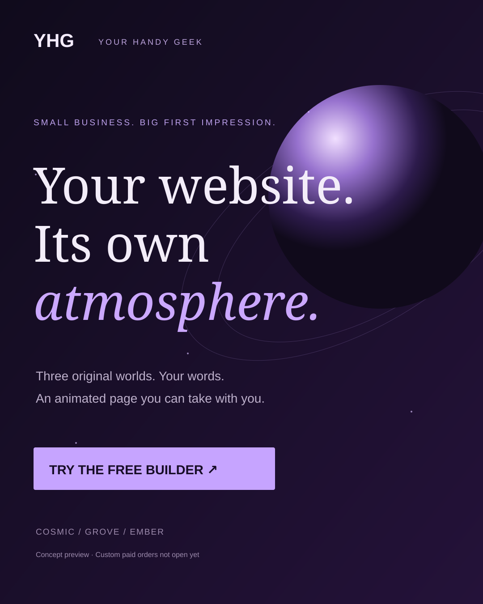

# Your Handy Geek — Launch Studio

**Your business has a personality. Your website should show it.**

[Try the live concept builder](https://omega-data-desk.tametruffle.chatgpt.site/studio/)

Choose Cosmic, Grove or Ember, edit your business name and message, then export
a standalone animated HTML page. The concept export uses original CSS motion,
responsive layouts and reduced-motion support. It has no tracking scripts,
remote fonts or framework dependency. Your edits stay in your browser.

## Need a custom website?

Your Handy Geek is developing a focused custom website service for independent
businesses. Project proposals start at $750 USD for an animated one-page site
with up to five sections, responsive layouts, a contact link, two revision rounds
and editable source. Final scope, timing, hosting and price are agreed individually.

[Email a project enquiry](mailto:yourhandygeek@gmail.com?subject=Website%20project%20enquiry)

This is a new service preview. There is no online checkout, paid advertising
campaign, claimed customer base or guaranteed business outcome.

## Run locally

Serve this folder with a static HTTP server, then open index.html. No installation
or build step is required. Run the export checks with `node check-studio.mjs`.

The HTML download is a concept. Replace illustrative business text and add your
real contact details before publishing. The service does not host files you export.

MIT licensed original demo source. Omega application code, credentials, account
databases, activation keys, personal files and model weights are not in this repository.
